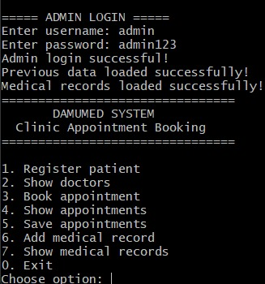

# Damumed: емханаға қабылдауға жазылу жүйесі

## Жобаның мақсаты
Java тілінде емханаға қабылдауға жазылу жүйесін жасау (консольдік қосымша).

## Зерттелген ұйым
Damumed: медициналық ақпараттық жүйе. Толық зерттеу: [docs/research.md](docs/research.md)

## Іске қосу

```
mvn compile
mvn test
java -cp target/classes kz.damumed.Main
```

Бағдарламаны жоба папкасынан (түбірден) іске қосу керек, өйткені дерек файлдары `data/` папкасында сақталады.

Демо кіру деректері (тек оқу жобасы үшін): `admin` / `admin123`

## Экран суреттері


## UML диаграммалар
`docs/uml/` папкасында: use-case, class, sequence, activity.